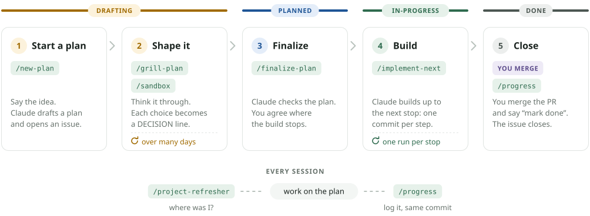
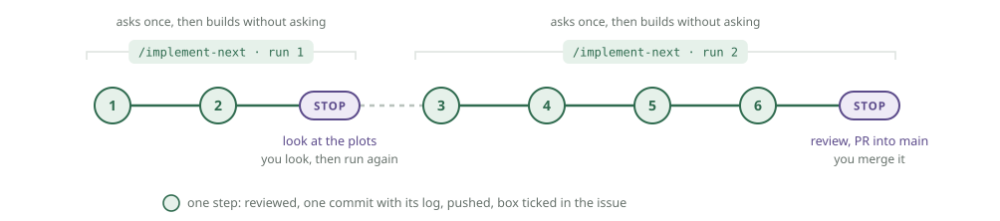
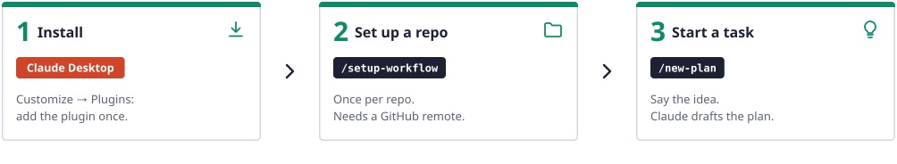

# research-workflow

**Claude skills for research repos.** You plan with Claude over days, and every session picks up where the last one stopped. Claude builds the plan step by step and stops where you said you want to look.

<picture>
  <source media="(prefers-color-scheme: dark)" srcset="docs/img/flow-dark.svg">
  
</picture>

## Why use it

- **Pick up where you left off**, even after weeks.
- **Keep every decision**, with its reason, one `grep` away.
- **Decide where Claude stops.** Between stops, it builds alone.

## How a build runs

<picture>
  <source media="(prefers-color-scheme: dark)" srcset="docs/img/runs-dark.svg">
  
</picture>

Each `/implement-next` asks once, then builds up to the next **Stop** in the plan (at most 5 steps). It also stops early if a test fails or a question comes up that the plan does not answer. Claude pushes the task branch after each step: allow `git push` in Claude Code's `/permissions` to skip the prompt.

## Get started

<picture>
  <source media="(prefers-color-scheme: dark)" srcset="docs/img/start-dark.svg">
  
</picture>

1. **Install.** In Claude Desktop, open **Customize → Plugins → Add marketplace** and enter:
   ```
   giulianonetto/research-workflow
   ```
   Then add the **research-workflow** plugin (connect GitHub if asked). Turn on **Sync automatically** to get updates.
2. **Set up a repo** with `/setup-workflow`. After an update, run it again: it shows what changed.
3. **Start a task:** say the idea, then `/new-plan`.

<details>
<summary>Claude Code without Claude Desktop</summary>

```bash
gh auth login && gh auth setup-git     # the repo is private
claude plugin install research-workflow --marketplace giulianonetto/research-workflow
```

Commands then carry the plugin's name: `/research-workflow:setup-workflow`. Install it one way only, or every command appears twice.

</details>

## Commands

| Command | When |
|---|---|
| `/project-refresher` | Start of a session: "where was I? what is next?" |
| `/project-refresher tasks` | All tasks with their status |
| `/new-plan` | A new task |
| `/grill-plan` | Hard questions about a draft plan |
| `/finalize-plan` | The plan is ready to build |
| `/implement-next` | Build up to the next stop |
| `/sandbox` | Check something by hand |
| `/progress` | Log work, change a status (or say "log progress") |

The plan can change at any time: just say what to change. All rules live in one file in your project, `plans/README.md`. All past decisions: `grep -rn '^- \*\*DECISION' PROGRESS.md plans/*/PROGRESS.md`

More: [the workflow on one page](docs/workflow.html) and [step-by-step examples](docs/examples.html) (new repo, new task, existing issue, continuing a draft). Download them and open them in a browser.

<details>
<summary><b>What it writes in a project</b></summary>

```
your-project/
├── CLAUDE.md              + a short workflow section
├── README.md              + a short workflow section
├── PROGRESS.md            the folder log: active tasks, status changes, PRs, releases
└── plans/
    ├── README.md          all the rules
    └── <task>/
        ├── PLAN.md        the plan: Goal, steps, stops
        ├── PROGRESS.md    the task log: work, DECISION lines, Next
        └── sandbox/       code for you to run and look at
```

</details>

## Credits

This project is heavily inspired by Matt Pocock's [mattpocock-skills](https://github.com/mattpocock/skills) (MIT License). `/grill-plan` and the Spec part of the review are adapted from it; see [NOTICE](NOTICE).

## Development

<details>
<summary>For work on this repo</summary>

This repo uses its own workflow: see [PROGRESS.md](PROGRESS.md) and [plans/](plans/). Every design decision is a DECISION line.

- `python3 tests/check_skills.py`: frontmatter, plugin manifest, versions, local links, stale names.
- `bash tests/check_scripts.sh`: runs the `run.sh` template and the refresher on a fake project.
- `python3 docs/figures.py`: redraws the README figures in `docs/img/` (light and dark).
- Both checks run on every push (GitHub Actions). Pushing a tag `vX.Y.Z` builds the zips and attaches them to a release.

Releasing: bump `version` in `.claude-plugin/plugin.json` and the `Workflow version:` line in `skills/setup-workflow/PLANS-README.md` (the checks fail if they differ), add a `## X.Y.Z` section to [CHANGELOG.md](CHANGELOG.md), then tag.

</details>
